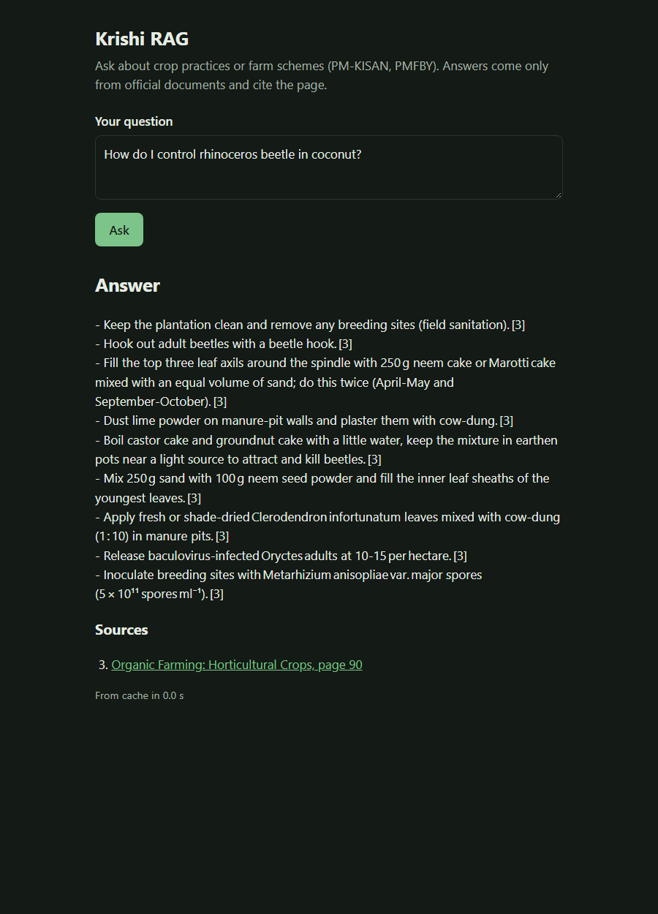
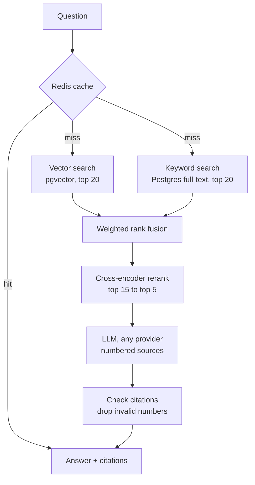

# Krishi RAG

[](https://github.com/akhil-sajan-mathew/krishi-rag/actions/workflows/ci.yml)

Ask a farming question in plain language and get a short answer drawn only from official crop guides and government-scheme documents, with every claim citing the document and page it came from. If the documents don't cover the question, it says so instead of guessing.



**At a glance**
- Retrieval-augmented generation (RAG) over 6 public documents (about 720 pages, 1,266 chunks): Postgres with pgvector, hybrid vector + keyword search, and a cross-encoder reranker.
- Works with any LLM: Claude, OpenAI, Gemini, Groq, OpenRouter, Ollama, or anything OpenAI-compatible.
- Answers questions asked in Hindi, in Hindi, from the same English documents.
- Measured on a hand-checked 60-question test set: **the right page is in the top 5 for 88% of questions; 81% average answer score; 92% of answers faithful to their sources; 9 of 10 off-topic questions correctly declined.**
- Production-ready setup: Docker, automatic HTTPS with Caddy, Redis caching and per-IP rate limits, CI on every push.

## How it works



1. **Ingestion** (`app/ingest.py`): PDFs are parsed page by page, repeated headers and footers are removed, and each page is split into chunks of up to 512 tokens (about 350 on average), so every chunk maps to exactly one page. Chunks are embedded locally with `bge-small-en-v1.5` and stored in Postgres.
2. **Retrieval** (`app/retrieve.py`): the question is searched two ways, by meaning (pgvector) and by words (Postgres full-text). The two ranked lists are merged with weighted reciprocal rank fusion, and a small cross-encoder reranks the top 15 down to 5.
3. **Answering** (`app/generate.py`): the 5 chunks are numbered `[1]`–`[5]` in the prompt. The model must cite a number after each claim, answer only the part the sources cover, and reply `NOT_FOUND` if they cover nothing. Citation numbers that don't match a real source are removed before the answer is returned.

## Results

All numbers come from [`eval/run_eval.py`](eval/run_eval.py) on [`eval/golden.jsonl`](eval/golden.jsonl); every run is logged in [`eval/results/summary.md`](eval/results/summary.md).

**Retrieval** (50 answerable questions; recall@5 = share of the evidence pages found in the top 5 results):

| Setup | recall@5 | MRR@10 | Median time |
|---|---|---|---|
| Vector only | 0.81 | 0.62 | 0.06 s |
| Keyword only | 0.53 | 0.39 | 0.05 s |
| Hybrid, equal weights | 0.72 | 0.57 | 0.08 s |
| Hybrid, keyword weight 0.5 | 0.82 | 0.61 | 0.08 s |
| **Hybrid (weight 0.5) + MiniLM rerank (default)** | **0.88** | **0.73** | 0.95 s |
| Same, with bge-reranker-base | 0.90 | 0.76 | 5.6 s |
| Default setup on 256-token chunks | 0.83 | 0.69 | 0.5 s |

**Full pipeline** (all 60 questions; `gpt-oss-120b` answering, `gpt-oss-20b` judging, via Groq):

| Measure | Result |
|---|---|
| Average answer score (half credit for partly right) | 81% |
| Fully correct | 76% |
| Faithful to the cited sources | 92% |
| Cites the right page | 84% |
| Answerable questions wrongly declined | 8% |
| Off-topic questions correctly declined | 9 of 10 |
| Average score by type | factual 87%, scheme 90%, two-part 55% |

**What the experiments showed**
- **The reranker is the biggest single gain** (MRR 0.61 → 0.73). The larger bge reranker finds about one more question in 50 but takes six times as long on a CPU, so the small one is the default.
- **Keyword search needs less weight.** On conversational questions it's weak on its own, and at equal weight it pulled hybrid search below vector search alone. At half weight it stops hurting.
- **Smaller chunks lost.** 256-token chunks scored lower than 512-token chunks, even when given the same total amount of text.
- **Answering part of a question beats declining it.** The first prompt declined 5 of 10 two-part questions outright when the sources covered only one half. After the change, none were declined and their average score rose from 40% to 55%; the trade-off is that a few partial answers wrongly say the other half isn't in the documents.
- **Most remaining errors are retrieval misses.** In 4 of the 5 wrong single-topic answers, the right page wasn't retrieved, so the model correctly declined.
- With 50–60 questions, one question moves a score by about 2 points, so differences under about 4 points are noise.

## Hindi questions

A question written mostly in a non-English script (for example Hindi) is first translated into an English search query by the LLM, searched against the English index, and then answered in the language it was asked in. If the documents don't cover it, the reply says so in Hindi. English questions skip the translation step.

Measured on a 16-question Hindi test set ([`eval/golden_hi.jsonl`](eval/golden_hi.jsonl), translations of English test questions with the same evidence pages):

| Approach | Hindi recall@5 | English recall@5 |
|---|---|---|
| English index, Hindi question as typed | 0.00 | 0.88 |
| Multilingual index (multilingual-e5-small) | 0.21 | 0.87 |
| Multilingual index (multilingual MiniLM) | 0.29 | 0.56 |
| **English index, question translated first (default)** | **0.86** | **0.88** |

Small multilingual embedding models couldn't match Hindi farming words (लौकी, सुपारी) to the English text; translating the question first nearly closes the gap with English. A spot check of three Hindi questions end to end (a crop fact, a scheme rule, and an off-topic question) gave correct Hindi answers citing the right pages, and a correct Hindi refusal. 

Full Hindi answer run (14 answerable questions + 2 off-topic, same LLM and judge as the English run):

| Measure | Hindi | English (60 questions) |
|---|---|---|
| Fully correct | 71% | 76% |
| Faithful to sources | 86% | 92% |
| Citation accuracy | 64% | 84% |
| Wrongly declined | 14% (2 of 14) | 8% |
| Off-topic declined | 2 of 2 | 9 of 10 |

Four answers were wrong: two were wrongly declined, one gave a neem-oil spray where the reference says dimethoate, and one said income-tax status doesn't affect PM-KISAN eligibility, which it does. With 14 questions a single answer moves a score by about 7 points, so read this as "somewhat below English", not as a precise gap.

## The test set

60 questions: 30 crop facts, 10 government-scheme questions, 10 two-part questions whose answer spans two pages, and 10 off-topic questions the documents don't cover (the right reply is to decline).

- Crop and scheme questions were drafted by an LLM from random chunks ([`eval/draft_questions.py`](eval/draft_questions.py), raw drafts in [`eval/drafts.jsonl`](eval/drafts.jsonl)). Every draft was checked against its source page: 2 of 50 had the wrong answer and were dropped, and most were reworded the way a farmer would ask.
- Two-part and off-topic questions were written by hand. Each off-topic topic was confirmed to have no match anywhere in the documents.
- Two reference answers were found to be wrong after the first run (several rice varieties tolerate iron toxicity, not one) and were rewritten; this is recorded in the results log.

Answers are graded by a second LLM against the reference answer and the retrieved sources. Retrieval, citation and refusal scores are computed by code.

## Run locally

Needs Python 3.11+, [uv](https://docs.astral.sh/uv/) and Docker.

```bash
cp .env.example .env              # then set an LLM provider (see below)
docker compose up -d db redis     # Postgres with pgvector, and Redis
uv sync
uv run python scripts/download.py # fetch the source PDFs
uv run python -m app.ingest       # parse, chunk, embed, store
uv run uvicorn app.main:app --port 8000
```

Open http://localhost:8000, or link straight to an answer: `http://localhost:8000/?q=seed rate for bottle gourd`.

From the command line:

```bash
curl -X POST localhost:8000/ask -H "content-type: application/json" -d '{"question": "What is the seed rate for bottle gourd?"}'
```

```json
{
  "answer": "The recommended seed rate for bottle gourd is three to four kilograms per hectare[2].",
  "found": true,
  "uncited": false,
  "cached": false,
  "citations": [{"n": 2, "document_id": "kau_pop_2016", "title": "Package of Practices Recommendations: Crops (15th ed.)", "page": 198, "url": "https://intranet.kau.in/sites/default/files/documents/pop2016.pdf"}],
  "mode": "hybrid_rerank",
  "latency_ms": 3613
}
```

`/ask` also takes an optional `mode`: `vector`, `keyword`, `hybrid` or `hybrid_rerank` (default). `GET /health` reports the database and Redis.

Run the evaluation:

```bash
uv run python -m eval.run_eval --retrieval-only        # retrieval only, no LLM needed
uv run python -m eval.run_eval --mode hybrid_rerank    # answer and grade all 60 questions
```

Run the tests: `uv run --group dev pytest`.

## Choosing an LLM

Set these in `.env`:

| Provider | `LLM_PROVIDER` | `LLM_BASE_URL` |
|---|---|---|
| Anthropic (Claude) | `anthropic` | leave empty |
| OpenAI | `openai_compatible` | `https://api.openai.com/v1` |
| Google Gemini | `openai_compatible` | `https://generativelanguage.googleapis.com/v1beta/openai/` |
| Groq | `openai_compatible` | `https://api.groq.com/openai/v1` |
| OpenRouter | `openai_compatible` | `https://openrouter.ai/api/v1` |
| Ollama (local, free) | `openai_compatible` | `http://localhost:11434/v1` |

Also set `LLM_MODEL` and `LLM_API_KEY` (any text for Ollama). The judge used by the evaluation has its own `JUDGE_*` settings; use a different model from the one answering, so it doesn't grade its own work. All of this lives in one small adapter ([`app/llm.py`](app/llm.py)); nothing else in the code knows which provider is in use.

## Deploying

The production setup is a Docker image (CPU-only PyTorch, models baked in, non-root user) plus Caddy for automatic HTTPS. Only Caddy is reachable from outside; the API, Postgres and Redis are not. It runs on any Linux server with 2 GB of RAM:

```bash
docker compose -f docker-compose.yml -f docker-compose.prod.yml up -d --build
```

Step-by-step guide (server, domain, `.env`, loading documents, updates, troubleshooting): [docs/deploy.md](docs/deploy.md).

**Caching and limits.** Answers are cached in Redis for 7 days; the cache key covers the question and every setting that changes answers (search settings, LLM, and the prompt itself). A repeat question returns in about 2 ms. Each IP address may ask `RATE_LIMIT_PER_HOUR` questions an hour (default 20). If Redis is down, both fail open: the API keeps answering, uncached and unlimited, and `/health` reports `"redis": "down"`.

## Design decisions

- **One database for everything.** Postgres stores the documents, the vectors (pgvector) and the full-text index, so hybrid search is two SQL queries and there's no separate vector service to run.
- **Embeddings run locally.** `bge-small-en-v1.5` is free, fast on a CPU, and keeps the search side independent of whichever LLM answers.
- **Chunks never cross pages.** Each page is split separately, so every chunk has exactly one page number and citations can always point to a page.
- **Citations are checked, not trusted.** The model cites numbered sources; the code keeps only numbers that match a retrieved chunk, accepts the formats real models produced (`[2]`, `【2】`, `[2†...]`), and flags answers with no valid citation.
- **The test set came first.** Every retrieval and prompt change was kept or dropped based on measured results, including changes that turned out not to help.

## Limitations and next steps

- **Hindi questions, English documents.** Hindi questions work through translation (above), but only English document text is indexed: the PM-KISAN PDF is half Hindi, and its Hindi text extracts as garbled characters. Hindi answers score a bit below English (above), and other Indian languages are untested.
- **Small corpus.** Six documents, two of them mirrors of official guidelines because the government sites weren't reachable during development. More sources can be added as rows in [`data/sources.csv`](data/sources.csv).
- **Two-topic questions.** One search rarely retrieves both topics; splitting a question into two searches would help.
- **Tables.** Dosage tables in the PDFs extract as loose text, and some answers misread them.
- **Small test set.** 60 questions are enough to catch large effects, not small ones.
- **Not deployed yet.** The production setup has been tested locally end to end, including HTTPS through Caddy, but not on a public server.

## Data sources

The source PDFs are listed with their publishers and URLs in [`data/sources.csv`](data/sources.csv): the Kerala Agricultural University crop guide, the TNAU organic horticulture guide, an ICAR rice pest-management guide, and PMFBY and PM-KISAN scheme guidelines. They belong to their publishers. They are downloaded by `scripts/download.py` and are not stored in this repository.

## Project layout

```
app/        API (main.py), ingestion, retrieval, LLM adapter, generation, cache, web page
eval/       test set, scoring, eval runner, results log
tests/      unit and API tests (no database or LLM needed)
scripts/    PDF download
docs/       deploy guide, screenshot
PLAN.md     the original build plan
```
